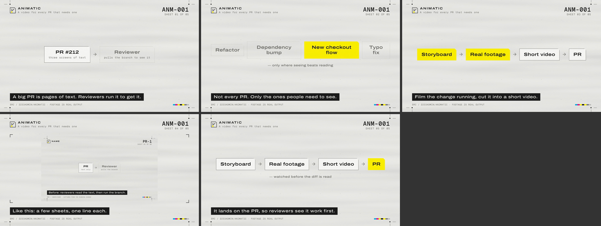

# animatic

[中文](README.zh-CN.md)

**When a PR needs one, it ships with a short video that shows how it works.**

animatic is an agent skill for that. Not every PR — refactors, dependency bumps and typo fixes
don't need a film. The ones a reviewer would rather see than read get thirty-odd seconds: real
footage of the change running, a few diagram sheets, one line of caption each. It renders with
[HyperFrames](https://github.com/heygen-com/hyperframes) and posts the video on the PR.

[](docs/assets/animatic-self.mp4)

<sub>One frame per shot of the film animatic made about itself (click for the 41-second video). The footage in it is real output.</sub>

## Why a script and not a prompt

A prompt that says "never draw a screen you didn't capture" or "leave every caption up long
enough to read" works until the model is in a hurry. Here those rules are checks:

| Rule | Where it is enforced |
|---|---|
| Product UI only from real captures | `check`: every `clip`, `image`, `compare` shot must point at a file that exists |
| Every caption readable in time | hold times are **computed** from the caption plus every on-screen word the previous shot did not show (5 字/s, 3 words/s by default) |
| Ten shots at most, short captions | `check` |
| What was planned is what was rendered | `render` measures the file: its length, and that each still shot looks the same just after it settles and just before it leaves |
| Captions legible at PR size, nothing covered | `render` writes a contact sheet at chat size for the agent to look at |
| Private code stays private | `attach` refuses private repos by default: GitHub serves comment attachments from an anonymous URL |

## Install

```bash
git clone https://github.com/2233admin/animatic
cp -r animatic/skills/animatic ~/.claude/skills/        # Claude Code; other hosts: their skills dir
```

Needs Node 20+, ffmpeg/ffprobe and Chrome. The renderer installs into the skill folder on the
first render. `vhs` is optional, for terminal footage.

## Use

Ask the agent for `/animatic` on a PR, or by hand:

```bash
A="node ~/.claude/skills/animatic/scripts/animatic.mjs"
$A new .animatic/pr-42                         # storyboard.json, scenes/, captures/
# capture footage into captures/, write scenes, fill the storyboard
$A check  .animatic/pr-42/storyboard.json
$A render .animatic/pr-42/storyboard.json      # → animatic.mp4 + contact sheet
$A attach .animatic/pr-42/animatic.mp4 --pr 42
```

Add `.animatic/` to the repo's `.gitignore`.

## Look

The default style, `ark`, treats the film as a document issued by the repository: the PR
number is the document number, each shot is a sheet, one brand colour marks what the PR
changed. It follows the industrial sci-fi grammar of
[arknights-printer](https://github.com/AspldeZ/arknights-printer) and its five dialects
(`field`, `terminal-dark`, `terminal-ice`, `paper`, `wartime`), with two changes for video:
text is sized for a player ~800px wide, and captures keep their own colours because they are
evidence. `plain` is a quiet dark style with no document chrome.

## Config

`.animatic.json` at the repo root:

```json
{
  "language": "en",
  "style": "ark",
  "dialect": "terminal-ice",
  "brand": "#e37222",
  "readingSpeed": { "cjkCharsPerSecond": 5, "wordsPerSecond": 3 },
  "attach": { "private": "release-asset", "maxMegabytes": 10 }
}
```

All keys and defaults: `skills/animatic/scripts/lib/config.mjs`.

## Layout

```text
skills/animatic/
  SKILL.md                 what the agent does, step by step
  scripts/animatic.mjs     new · check · render · attach · doctor
  scripts/lib/             timing, checks, build, verify, attach (no runtime deps)
  schema/                  storyboard JSON schema, for editors
  assets/styles/           ark, plain
  references/              writing a storyboard, capturing footage
examples/self/             the storyboard behind the film above
tests/                     node --test
```

## License

MIT
