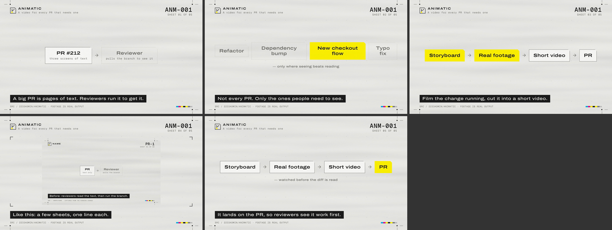

# animatic

[English](README.md)

**在需要的时候，每一个重要的 PR 都能附带一段视频，展示它是如何运作的。**

animatic 就是做这件事的 agent skill。不是每个 PR 都要拍：重构、依赖升级、改错字都不用。审查者宁愿看也不想读的那些 PR，才配一段三四十秒的视频：这次改动真实运行的画面，几张示意图，每个镜头一行字幕。用 [HyperFrames](https://github.com/heygen-com/hyperframes) 渲染，最后贴到 PR 评论里。片子里的文字默认用英文。

[](docs/assets/animatic-self.mp4)

<sub>这是 animatic 给自己做的介绍片，每个镜头截一帧（点开看 41 秒的视频）。片子里录到的画面都是真实输出。</sub>

## 为什么写成脚本，不写成提示词

"没截过的界面不许画""每条字幕都要留够时间读完"，这种规则写在提示词里，模型一赶时间就会漏。animatic 把它们做成了脚本检查：

| 规则 | 由哪里保证 |
|---|---|
| 产品界面只能来自真实录制 | `check`：每个 `clip`、`image`、`compare` 镜头都必须指向一个真实存在的文件 |
| 每条字幕都读得完 | 停留时间是**算出来的**：字幕，加上上一张没出现过的画面文字，按字数算（默认每秒 5 字、3 个英文词） |
| 最多 10 个镜头，字幕要短 | `check` |
| 渲染出来的和计划的一致 | `render` 检查成片：总时长对得上；每个静止镜头在刚定住和即将离开时画面一致 |
| 在 PR 里的播放尺寸下看得清，没有东西被挡 | `render` 按聊天窗口的尺寸生成一张联系表（每个镜头截一帧），交给 agent 看 |
| 私有代码不外泄 | `attach` 默认不往私有仓库贴视频：GitHub 的评论附件用的是匿名链接，拿到链接的人都能看 |

## 安装

```bash
git clone https://github.com/2233admin/animatic
cp -r animatic/skills/animatic ~/.claude/skills/        # Claude Code；其他宿主放进各自的 skills 目录
```

需要 Node 20+、ffmpeg/ffprobe 和 Chrome。渲染器在第一次渲染时自动装进 skill 目录。录终端画面要装 `vhs`，不装也能用。

## 用法

在 PR 上让 agent 执行 `/animatic`，或者手动跑：

```bash
A="node ~/.claude/skills/animatic/scripts/animatic.mjs"
$A new .animatic/pr-42                         # 生成 storyboard.json、scenes/、captures/
# 把录好的素材放进 captures/，写好示意图，填好分镜
$A check  .animatic/pr-42/storyboard.json
$A render .animatic/pr-42/storyboard.json      # → animatic.mp4 + 联系表
$A attach .animatic/pr-42/animatic.mp4 --pr 42
```

记得把 `.animatic/` 加进仓库的 `.gitignore`。

## 画面风格

默认风格是 `ark`：把整支片当成仓库发出的一份文件，PR 编号就是文件编号，每个镜头是其中一页，只用一个品牌色标出这次改了什么。它沿用 [arknights-printer](https://github.com/AspldeZ/arknights-printer) 的工业科幻画面语法，以及五种方言（`field`、`terminal-dark`、`terminal-ice`、`paper`、`wartime`）。为了适配视频改了两处：字号按 800px 左右的播放宽度放大；截图保留原色，因为它们是证据。另一种风格是 `plain`：安静的暗色画面，没有页眉页脚。

## 配置

在仓库根目录放一个 `.animatic.json`：

```json
{
  "language": "en",
  "style": "ark",
  "dialect": "terminal-ice",
  "brand": "#e37222",
  "readingSpeed": { "cjkCharsPerSecond": 5, "wordsPerSecond": 3 },
  "attach": { "private": "release-asset", "maxMegabytes": 10 }
}
```

全部配置项和默认值见 `skills/animatic/scripts/lib/config.mjs`。

## 许可

MIT
